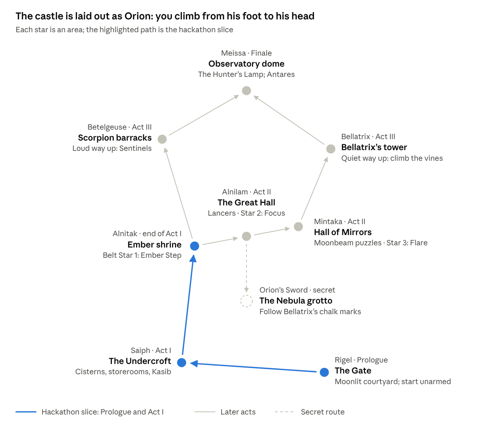
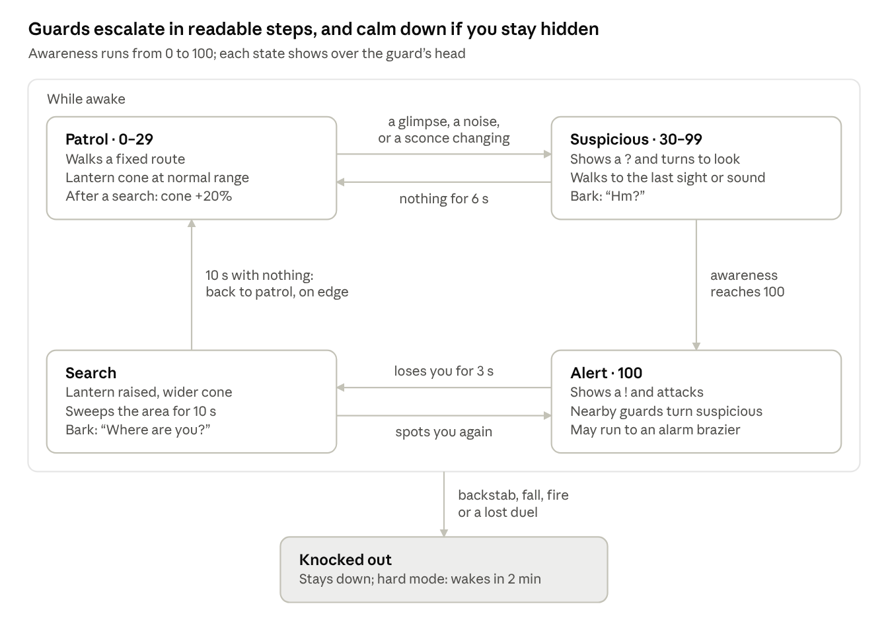
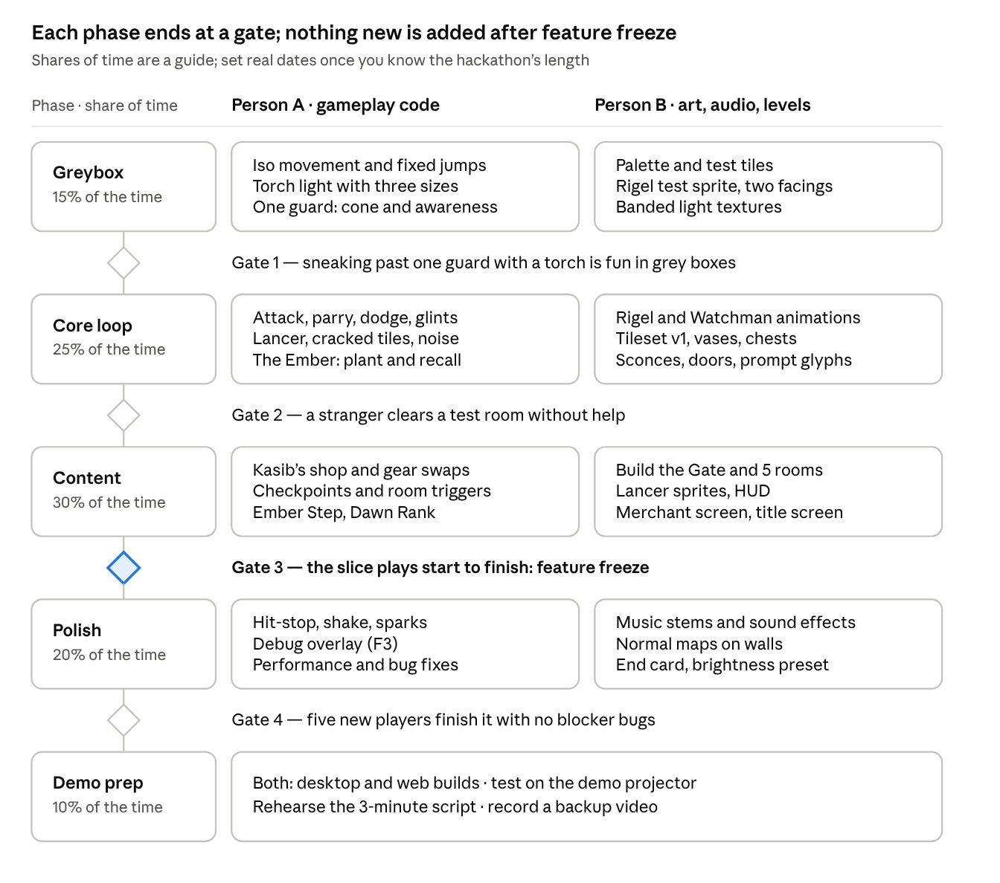

# ORION

A small prince carries the last flame into a dark citadel. Every light that shows him the way also gives him away. He has until Orion sets.

ORION is an isometric pixel-art game of stealth and sword duels, inspired by the feel of Prince of Persia and planned for a hackathon. The engine will be Godot 4.3+. No code yet: the team is still finalising the plan.

## Design

- [Game Design Document](docs/GDD.md) — Persian-inspired setting. A Markdown snapshot of the live Claude Doc, exported on 2026-10-17. The live doc is the one to edit: <https://claude.ai/artifact/DkETn7xHUMDvHV2gPv3CLH> (ask Adithya for access).
- A Greek-setting version is being drafted so the two can be compared before choosing one.

## Diagrams

| Castle map | Guard awareness | Build roadmap |
| --- | --- | --- |
|  |  |  |

## Status

Planning. Answer the doc's "Open questions" section before writing any code.
